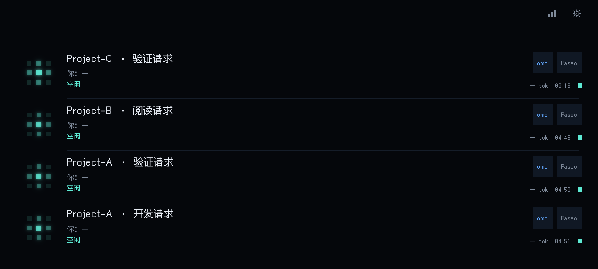

# #14：Paseo 新建 omp 会话发现

日期：2026-09-22。范围：[开发票 #14](https://github.com/XJM034/AgentPager/issues/14)，父规格 [#13](https://github.com/XJM034/AgentPager/issues/13)。现行入口：[开发接入说明](../paseo-omp-development.md)。

## 已实现

- Paseo 0.8.0 官方 `agent.created` + 公开 SDK 目录订阅、分页初始清单；创建事件读取公开 ref.refresh 权威快照。
- 仅 Paseo omp：排除其他 provider、归档/closed 历史；创建回调排除带 parentAgentId 的子会话事件，SDK 目录快照不提供该字段。模型不参与来源或身份。
- 独立认证的 loopback 入口、大小/连接/超时/安全摘要队列上限；Bridge 实际启动接线与目录持久化。
- 主机命名空间 + agent ID 的 SHA-256 身份，同目录并发、多项目、重复事件、跨主机不冲突。
- 有限标题类别、末级项目名；idle 保持非完成语义、无虚假审批能力。Android 使用现有卡片、排序、焦点与声音基线，新增 omp / Paseo 来源标记。
- Swift/Kotlin/C# 来源编解码和混合未知来源共享 fixture；Windows 不增加采集。
- 独立开发启动模式和只准备配置的脚本，不自动安装、覆盖运行 App、修改 Paseo 配置或调用模型。

## 首次实现提交时的验收与证据

本节保留 `a2b7d7069ebec046eb71032a34b2f5856e00aa00` 提交时事实；同一 Session 继续完成的真实验收见末节，以下“待验收”不代表最终状态。

| #14 验收项 | 结果 |
| --- | --- |
| 尚未输入即可自动显示，空闲可见 | 真实 Bridge WebSocket + Android 投影测试通过；真实 Paseo/Redmi 待验收 |
| 真实 idle/starting、无伪造完成、首次提醒基线 | 自动化通过 |
| 只接 Paseo omp | 受控官方边界测试通过；独立终端无采集入口 |
| 安全标题、项目、明确来源且模型不影响身份 | 两端测试及实际适配器链路通过；不读取模型 Key |
| 同目录/多项目/跨主机/重复创建 | 实际适配器 → 本地 TCP → Bridge → WebSocket 测试通过 |
| 初始分页清单 + 创建，忽略归档和 closed 历史 | 测试通过；全面断线恢复留后续票 |
| 原有来源、额度、配对 | 完整回归通过；未改额度来源与配对协议 |
| 本地认证与敏感数据不进入手机/持久化/诊断 | 错误 token 拒绝及合成敏感标记检查通过；监听明确绑定 loopback |
| 三端协议与未知来源兼容 | Swift/Android 测试通过；C# 源码与测试已补，当前无 .NET SDK，未执行 |
| 开发启用、撤销、演示 | 已提供可重复步骤；未安装到真实 Paseo/Android 或替换 Bridge |

TDD 记录：先添加隔离 WebSocket 验收并看到缺少接入接口的编译失败；实现后通过。再接实际 JS 适配器，缺少模块时失败，实现后通过。补 closed 历史用例后发现错误导入，过滤后通过。补目录 initializing → 创建完成 idle 的测试后发现启动状态未收敛，修正后通过。Android 来源测试先因 `omp` 回退未知失败，补来源与标签后通过。测试输入是受控 SDK/生命周期数据，不能宣称真实 Paseo 已验收。

检查：

- `swift test --package-path macos`：177 项 Core + 13 项 Bridge，共 190 项通过。提交前复跑曾遇到未修改的 accountUsageStdioHandshake 2 秒超时；额度组 5 项和该用例单独复测通过，最终全量复跑通过。本票没有修改额度实现或放宽该测试。
- `JAVA_HOME=...openjdk@17... ./gradlew testDebugUnitTest lintDebug assembleDebug`：88 项 Android 单元测试通过，Lint 与 Debug 构建通过。
- `npm ci --prefix integrations/paseo-omp --ignore-scripts` / `npm run check --prefix integrations/paseo-omp`：固定 0.8.0 官方 SDK 类型检查通过。
- 工具链：Xcode 27.0 (27A5252f)、Swift 6.4、macOS SDK 27.0；Android JDK 17.0.19、Gradle 8.13。
- 实际隔离开发可执行程序已启动并接收生产适配器的受控输入，随后只终止该隔离进程。启动瞬时 RSS 约 87 MiB、CPU 28.2%，仅启动观察，不是稳态或长期性能验收。
- 设备检查：本轮 adb 无连接设备。构建保持 `.custom` 包名；没有安装或版本覆盖。
- 基线提交 `8440cd0c41ce06bec8a2bcaa80b91a6192c0b1cc`，分支保持 `alexx_custom`。本轮不推送、不发布、不关闭父 Issue。

## 审查与文档

按 code-review 分别审查 Standards 与 Spec。首轮 Standards 提出订阅/并发测试证据和子会话过滤说明两项，已补 SDK upsert、Promise.all 创建用例并缩窄说明；Spec 未发现确认的需求偏差。最终复核：Standards 两项均关闭，无剩余发现；Spec 0 项发现。按 claude-agents-bootstrap 核对入口，现有根规则已覆盖协议、安装与验证边界，只增加文档索引及 macOS 开发入口，不重写根规则。保留用户已有的 CONTEXT、规格、研究、拆票文档与索引改动，只暂存本票新增索引段落。

## 首次提交时的后续与未验证

真实 Paseo 插件安装/加载、Codex/GLM 各创建真实会话、Redmi 卡片与提醒、签名升级以及长期资源占用未验收。未做模型调用，未替换 `/Applications`，未改真实 Paseo daemon 或审批模式。本票只做发现，连续轮次状态、归档后清理、异常和跨连接恢复都不在此阶段。

#15 已具备代码接线、稳定身份、来源和测试接缝基础；GitHub 上 #14 尚未关闭，因此按现行票据规则，#15 尚未进入正式可开发前沿。须先完成本票验收/获准豁免并按授权处理 #14 状态；本轮不继续实施 #15–#18。

## 同 Session 补充真实验收

用户指出 #14 不应将未完成验收移交下次 Session，本轮继续完成了本票的隔离、可恢复演示范围，没有缩减验收条件。实现提交为 `a2b7d7069ebec046eb71032a34b2f5856e00aa00`；后续只补文档和现场证据，不改生产代码。#14 开发和本票验收已完成；#18 的正式安装管理与 Redmi 硬件验收仍未实施。

### Agent 实测结果

1. 用 Paseo **0.8.0** 官方 CLI 在独立临时 home、loopback 端口启动真实 daemon；安装实际插件，设置该隔离 daemon 的 `pluginsEnabled=true` 和 omp enabled 后确认 **running**。发现并补记全局插件开关这一启用前提。日常 daemon 和 `/Applications` 未改动。
2. 公开 SDK 实际创建 **5 条** omp **18.2.8** 会话，跨 **4 个项目**，其中同项目两条；模型分别选择 `openai-codex/gpt-5.5` 和 `zhipu-coding-plan/glm-5.3`。全部省略 prompt，前后 refresh 均确认 idle / lastUserMessageAt=null，没有发送模型消息或执行推理。
3. 真实隔离 Bridge 的手机 WebSocket 收到前三条后，Android **medium_phone / emulator-5554** 实际显示三张 `omp / Paseo` 空闲卡片。保持连接后再创建第四条，Android 自动显示新卡，**没有逐条登记、手动刷新或发送首条消息**。UI 布局与截图均检查通过；没有完成标记、提示词或审批能力。
4. 连续两次官方 `plugin reload` 后，四条 WebSocket task 对象全量比较相等：无重复，稳定 ID、时间与状态不变。关闭插件期间创建第五条，Bridge 仍四条；启用后由初始清单补为五条，前四条全量不变，Android 实际显示 Project-D 新卡。
5. 官方 `plugin remove` 后，daemon 仍可访问，五条真实会话均保持空闲且无用户消息；随后仅停止本次隔离 daemon、Bridge 和模拟器。没有重启或替换用户日常服务。
6. 模拟器原版为 `.custom` Build 20；已备份 APK/应用数据、核对 Debug 签名一致，临时安装本票 **Build 22**。验收后不卸载、不清数据地恢复 Build 20，再恢复备份数据，逐文件 SHA-256 一致，原配对文件未输出。没有连接或操作 Redmi。
7. 临时目录安装 **.NET SDK 8.0.425**（不改全局 PATH），按原 Windows 目标运行 `dotnet run --project windows/tests/AgentPager.Core.Tests -p:EnableWindowsTargeting=true`，**7/7 通过**，含 omp/unknown 共存和序列化往返。此结果覆盖 Core 编解码，不代表 Windows 桌面 App 运行验收。

截图来源是实际模拟器，不是 mock。Project-A/B/C 是本轮私有临时项目名；画面没有账号、配对密钥、完整路径或提示词。运行配置、密钥、原应用数据备份仅在权限受限的临时目录，不进入 Git。

### 最终验收归纳

- 未发送首条消息即自动出现、同项目/多项目、Codex/GLM 来源、真实空闲语义、初始有效清单、实际启用和撤销：**真实链路实测通过**。
- 稳定身份、重复发现：真实插件重载及隔离集成测试均通过；跨主机、归档/其他来源排除、错误 token、敏感数据过滤：自动化通过。
- Android 可见性、首次提醒基线、其他来源/额度/配对回归：现有 **88 项单元测试、Lint、Debug 构建**通过；实际四卡渲染通过。模拟器不证明 Redmi 的通知、振动和后台行为。
- Swift **190 项**、SDK 类型检查通过；Windows Core **7 项**补跑通过。生产源码未再变化，不重复扩大测试。
- Standards / Spec 原有审查均无剩余发现；补充文档与截图再经同两轴独立复核：Standards 0 项、Spec 0 项，无阻断发现。当前文档、启用前提和交接已同步。

尚未验证的是 **#18 范围**的 Redmi 真机提醒/后台、正式安装签名升级和长期性能；#15–#17 的手机审批、完整轮次进度与全面恢复也未扩做。本票没有依赖模型调用完成验收。

下一票 #15 已具备实现和验收前置基础。本次授权只含本地提交，未写 GitHub 评论或修改 Issue 状态；#14 在远端仍 OPEN，因此 tracker 的阻塞关系尚未解除。这是外部状态收尾，不是把 #14 的开发或验收留给下一 Session。不推送、不发布、不关闭父 #13，不继续实施 #15–#18。

### GitHub 状态收尾

2026-09-22 15:35（Asia/Shanghai），用户要求在本 Session 完整收尾并直接交付 #15 prompt 后，已将 #14 关闭为 completed，回读状态 CLOSED。#15 原生 blocked_by 仅返回 #14，且 state=closed；下一票已进入可开发前沿。父 #13 保持 OPEN。实现、验收和外部状态收尾均无需转交下一 Session。上述“仍 OPEN”是首次文档收尾时的历史状态，由本节更新。

本次仅同步记录并本地提交，没有推送、发布、修改父规格或实施 #15–#18。用户明确要求后续每票在各自 Session 内完成实现、验证、审查、文档、提交及获授权的 Issue 收尾，再给下一票可直接执行的完整 prompt。
